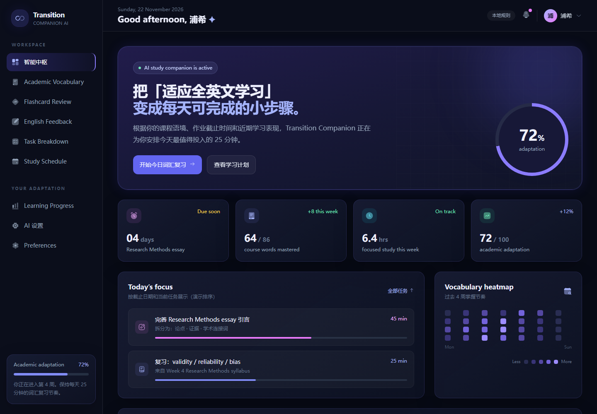

# 浦希 · 个人作品集

个人网站：**[https://cycy408.github.io/](https://cycy408.github.io/)**

一个面向软件开发 / 数据分析实习的静态作品集，记录项目背景、个人贡献、验证结果和已知局限。



## 内容

- **首页**：个人介绍、技术方向与主项目入口
- **主项目**：Transition Companion，离线优先的 AI 学习助手
- **另一个项目**：高简教育平台，负责官网、会员方案和顾问服务页面的前端设计与优化
- **项目详情**：问题、方案、我的角色、验证结果、局限和下一步
- **截图切换**：任务计划 / 词汇复习 / 学习总览
- **关于我**：教育背景、技术方向和常用工具
- **联系**：公开邮箱、GitHub 和简历 PDF

## 技术实现

- 单个 `index.html`，CSS 内联，无需前端构建
- 原生 JavaScript，无 React、npm 或后端依赖
- 本地字体栈、本地图片和本地 PDF
- 深浅色主题切换，使用 `localStorage` 记忆选择
- 键盘可访问的项目截图 tab
- 响应式布局，适配手机、平板和桌面
- 支持 `prefers-reduced-motion`

## 目录

```text
.
├── index.html
├── assets/
│   ├── transition-overview.png
│   ├── transition-tasks.png
│   ├── transition-flashcards.png
│   ├── gaojian-home.png
│   ├── gaojian-membership.png
│   ├── gaojian-consulting.png
│   └── resume.pdf
├── .nojekyll
└── README.md
```

## 本地预览

直接双击 `index.html`，或用任意静态文件服务器打开仓库根目录。

## 发布

仓库使用 GitHub Pages：

```text
Source: Deploy from a branch
Branch: main
Folder: /(root)
```

发布地址：

```text
https://cycy408.github.io/
```

## 更新方式

1. 修改 `index.html` 或替换 `assets/` 中的文件
2. 提交到 `main`
3. 等待 GitHub Pages 自动部署完成
4. 刷新线上页面检查

## 说明

- 网站是纯静态页面，不包含登录、数据库或在线 AI 服务。
- `assets/resume.pdf` 是公开简历，公开前请确认其中的个人信息范围。
- 项目源码与在线演示链接暂时未公开，页面中只保留了邮件联系方式。
